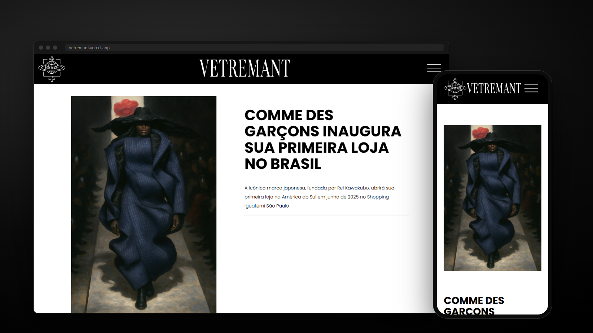
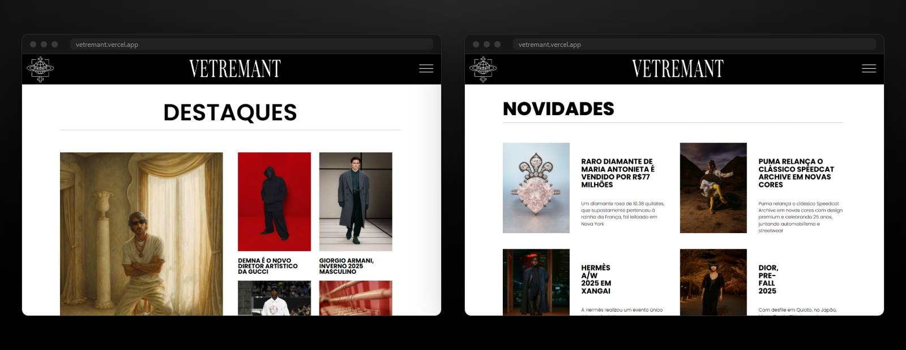
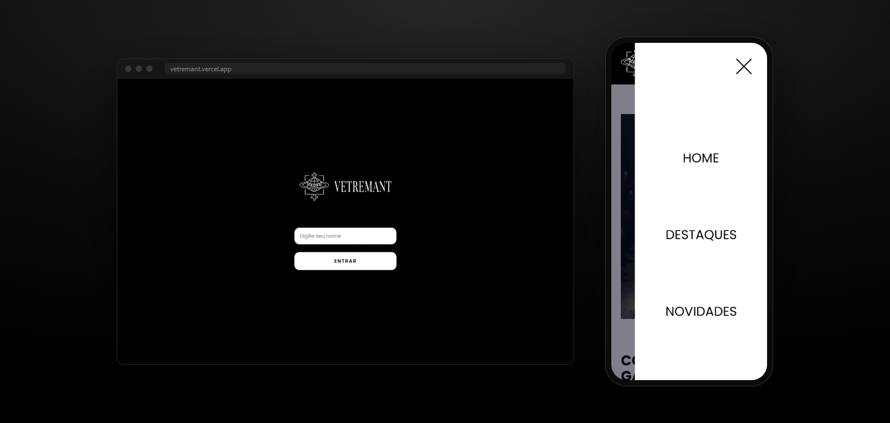

# Vetremant

Portal de notícias sobre moda feito na disciplina de Programação Web da ETEC, em 2025. O site reúne matérias sobre marcas, desfiles e mudanças de direção criativa, separadas nas seções **Destaques** e **Novidades**. Cada matéria tem a sua própria página.

<p align="center">
  <a href="https://vetremant.vercel.app/"></a>
</p>

<p align="center">
  <a href="https://vetremant.vercel.app/"><strong>Acessar o site</strong></a>
</p>

## Funcionalidades

- **Tela de entrada:** o visitante digita o nome e é levado para a página inicial.
- **Página inicial:** matéria principal em destaque, seguida das seções Destaques e Novidades.
- **Páginas de matéria:** cada notícia tem sua própria página com título, resumo e imagens.
- **Menu lateral:** abre por cima do conteúdo, escurece o fundo e rola suavemente até a seção escolhida.
- **Fale Conosco:** formulário de contato com nome, e-mail e assunto.
- **Layout responsivo:** folha de estilo própria para telas de celular.

## Telas

<p align="center">
  
</p>

<p align="center">
  
</p>

## Tecnologias

- **HTML** para a estrutura das páginas
- **CSS** para o layout, com estilos separados para desktop, páginas internas, contato e celular
- **JavaScript** para o menu lateral, a rolagem suave e a tela de entrada
- **Vercel** para a hospedagem

## Estrutura

```text
Vetremant/
├── index.html          tela de entrada
├── pages/              página inicial, matérias e contato
├── style/              folhas de estilo (desktop, páginas internas, contato, mobile)
├── js/                 menu, rolagem e entrada
└── assets-images/      logo, ícones e imagens das matérias
```

## Como rodar

O projeto é estático, então basta abrir o `index.html` no navegador ou usar uma extensão como o Live Server.

```bash
git clone https://github.com/twkryan/Vetremant.git
cd Vetremant
```

## Observações

Projeto feito para fins de estudo. As marcas, nomes e imagens citados pertencem aos seus respectivos donos.
